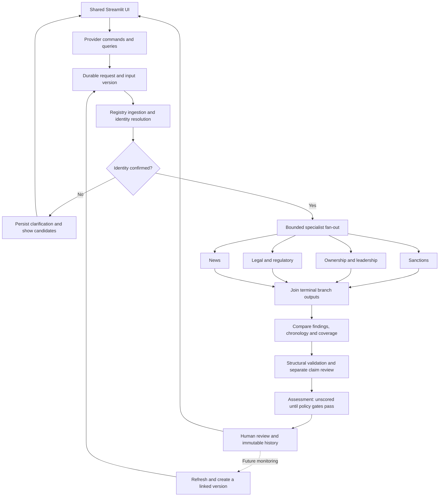

# Application architecture

Canonical target architecture, reconciled with code on 2026-10-14.
[Status](../status.md) describes what runs, [scope](../product/scope.md) owns product
decisions, and [backlog](../backlog/README.md) owns remaining work.

## Application flow

This is the intended durable flow. The local LangGraph runs implemented specialists
when enabled. Snowflake handlers do not inject them. Structural validation exists;
independent claim adjudication and scoring do not. The selected UI invokes the local
graph rather than the planned durable command/read interface.

## Responsibilities

| Component | Owns | Current boundary |
| --- | --- | --- |
| UI | Input, candidates, progress, evidence and reviewer interaction | [ui/app.py](../../ui/app.py); planned durable command/read contract |
| Application binding | Installation/actor context, validated commands, authorized projections | Planned provider-owned modules |
| Execution | One run owner, dependency graph, attempts and native states | [local graph](../../src/trust_signal/orchestration/case_graph.py), [StageRunner](../../src/trust_signal/orchestration/stages.py) |
| Source adapter | Protocol, parsing, pagination and access gate | [registry](../../src/trust_signal/connectors/registry.py) |
| Ingestion | Retain exact response, verify receipt and source-run coverage before release | [pipeline](../../src/trust_signal/ingestion/pipeline.py) |
| Identity | Scoped resolution and attribution gates | [resolver](../../src/trust_signal/resolution/resolver.py) |
| Specialist | Bounded requests and typed findings with provenance/limitations | [agents](../../src/trust_signal/agents) |
| Aggregation | Grouping, duplicate evidence, potential conflicts and timeline | [aggregator](../../src/trust_signal/aggregation/service.py) |
| Validation | Structural lineage checks; claim review stays separate | [validator](../../src/trust_signal/research/validation.py) |
| Assessment | Unscored route; future policy and explanation | [graph](../../src/trust_signal/orchestration/case_graph.py) |
| Review | Rationale, snapshots, versions, idempotency and history | [ReviewService](../../src/trust_signal/research/review.py) |

Components do not require separate microservices. UI rerenders do not provision
resources or own durable execution. Source/research algorithms remain shared;
concrete SQL, SDKs, setup and native execution belong to provider adapters.
[Component layout](components.md) records current coupling and intended placement.

## Execution and recovery

Cases have stable case/tenant identifiers, input versions and immutable run
snapshots. Runs contain stage attempts, source-run references and terminal outputs.
Execution status, evidence coverage and disposition are separate: a successful
engine may return unresolved identity or incomplete research. Current enums and
schemas live in [models](../../src/trust_signal/models.py) and
[workflow contracts](../../src/trust_signal/domain/workflow.py).
Application entrypoints are Python, CLI and SQL; no product HTTP API is implemented.

The target durable adapter must:

1. Persist a validated request before acknowledging it; bind trusted installation
   and actor context outside editable input.
2. Confirm identity before attribution. Clarification ends execution; corrected
   input creates a linked version instead of rewriting earlier evidence.
3. Bound source calls, concurrency, aliases, results, payloads and deadlines.
   Every enabled branch has an explicit terminal output before the join.
4. Reuse completed outputs across restart/retry; distinguish source gaps from
   programming/storage failures and reconcile unknown writes first.
5. Fence expired owners and reject competing writes. Stable IDs and table DDL alone
   do not prove concurrent exactly-once processing.
6. Record cancellation and retain evidence. Decouple notifications using idempotent
   outbox/inbox handoff after case/review commits.

These are acceptance requirements, not claims that every mechanism exists.
Snowflake currently claims one case per graph run without overlapping graph runs;
its concrete semantics are in [workflow operations](../operations/snowflake-workflows.md).
Shared-source refresh and per-case research are separate workflows. Reuse permitted
immutable snapshots instead of fetching global lists per party; refresh creates new
versions and preserves reviewer history.

## Data and evidence

| Record family | Meaning |
| --- | --- |
| Source configuration | Authority, jurisdiction, operations, version, rights, access and cadence |
| Source run | Scope, times, counts, coverage, failure category and observation IDs |
| Observation | Original body, stable record/observation IDs, URL, hash, connector version, retrieval time and optional publication time |
| Identity research | Submitted input, scoped identifiers, candidates, reasons and resolver-policy version |
| Relationship/event | Subject, direction/role, effective/event dates, procedural state, source fields and uncertainty |
| Finding/evidence | Claim, attribution, observation/run references, locator and verification state |
| Case/run/attempt | Input version, ownership, status, output and correlation IDs |
| Aggregation/validation | Original finding references, comparisons, gaps and validation-policy version |
| Assessment/review | Policy if applicable, reasons, snapshot hash, actor, rationale, expected version and command ID |

Typed contracts are in [domain](../../src/trust_signal/domain) and
[models.py](../../src/trust_signal/models.py). Designed fields or empty tables do
not establish completed normalized storage.

Keep operational, evidence and analytical storage distinct. Operational state needs
transactional ownership/review consistency; evidence needs original bytes and verified
readback; analytics contains dated projections. An analytical row cannot authorize
a review or declare authoritative case completion.

Retain original decoded responses separately from parsed JSON/extracted claims.
Verify bytes and metadata before releasing records. Unknown writes, orphan objects
and incomplete chunks require reconciliation. Publication, event, retrieval, ingestion
and verification times differ; unknown times stay unknown. Corrections create new
assertions with effective/system-observation times and retain prior history.

## Bounded AI behavior

Current specialists are deterministic. Future models may extract, classify,
translate, summarize or answer from permitted evidence. Output remains a candidate;
models cannot confirm identity, grant access/eligibility or execute review decisions.

Use explicit source/tool allowlists and budgets. Source pages/uploads are untrusted,
including embedded instructions. Record code-owned tool calls, evidence IDs,
model/prompt/schema versions and validation outcomes. Do not invent telemetry or
display hidden reasoning.

Bind installation/tenant, case version, document access and policy dates before
building model context. Verify citations, revocation/deletion, index freshness and
abstention on gaps. Models have no arbitrary privileged SQL or mutation tool access.

## Assessment and human authority

Identity certainty, evidence support, coverage and risk severity are different.
Current `risk_score` is null. Structural checks and human commands do not establish
claim truth.

Future scoring requires eligibility, version/effective date, named approval,
procedural-state treatment, event deduplication and labeled evaluation. Scales,
weights and thresholds stay undecided until approved. Missing coverage produces
reasons/review, never a fabricated zero. Active designations/proceedings need their
actual status rather than generic time decay.

Review requires a trusted actor, snapshot hash, expected version and command ID.
Preserve rationale and history. Current ReviewService supports review, request-details,
reject and supervisor reopen; approval, monitoring and business side effects are
additional work.

## Security, operations and evaluation

Trust boundaries run from untrusted sources through restricted RAW evidence,
validated outputs, authorized views and minimal model context. Use scoped workload
identities, least privilege, source egress/SSRF/redirect controls, bounded parsing and
parameterized SQL. Secrets and unnecessary personal data stay out of UI/prompts/logs.
Multi-user use requires verified membership and tenant-bound reads/writes.

Retention, redaction, deletion, revocation and export rights cover original objects,
normalized data, indexes, projections and copies. Append-only application history
is not protection from database administrators. Review residency/inference geography
per profile; choose and measure recovery objectives and restore drills.

Correlate case/run/stage/attempt/source-run/observation/policy IDs. Measure stuck
runs, failures, source freshness/publication lag, schema drift, authorization denials,
citation failures, duplicates, overrides and cost per source/case. Alerts need owners
and tested recovery actions. Bound query/page/time/retry/token/document/compute budgets
and account for standing service costs. Billing alerts and warehouse monitors do not
provide a universal spending cap.

Test schemas, connector failures/rights, restart/replay/ownership, claim/identity
quality, isolation, approved cloud integration, UI journeys and measured load/cost.
Use labeled temporal holdouts across jurisdictions/scripts and same-name entities;
measure false attribution, unsupported claims, procedural changes, duplicate reporting
and reviewer outcomes. [Readiness](../deployment/readiness.md) owns release gates.
