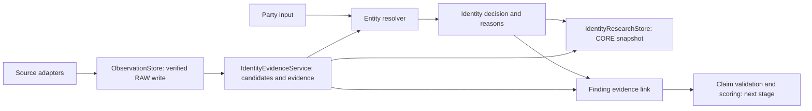

# Entity resolution and evidence implementation

This is the first implemented identity policy (`identity-0.1`). It supports global
names and identifiers through portable Python contracts. Country-specific registry
validation, temporal entity merging and analyst-confirmed associations are later steps.

## Flow and boundaries

### Intake journey

1. Enter a legal name and search GLEIF. Show candidates; do not dispatch specialists.
2. Select a candidate. Perform a fresh exact-LEI lookup through the ingestion
   pipeline, retain its response, and check name/LEI/jurisdiction consistency.
3. On confirmation, populate national registration ID, registration authority,
   registered address and aliases. Show headquarters address, legal form, entity
   status and LEI registration status separately. Retain all returned record
   attributes, including dates and additional fields, in the profile. Dedicated
   relationship and mapped-identifier endpoints are not called at this step.
4. Allow **Save Draft Intake** without research. The current local UI saves the
   inputs and identity profile only in Streamlit session state; durable draft
   saving and reopening remain pending.
5. **Launch Autonomous Research Pipeline** is the explicit research boundary.
   Live mode requires a matching confirmed identity in both UI and local backend.
   Fixture search also avoids the case graph; fixture research is illustrative.

Implementation: `LiveIdentityService` in `src/trust_signal/application/identity.py`,
the shared `EntityRecord` contract, `GleifAdapter`, and `ui/views.py`.
The local application retains evidence in memory unless durable stores are injected.
The UI's editable intake fields and the retrieved source profile remain separate;
editing a name, LEI or jurisdiction revokes the displayed confirmation.

### Next bounded implementation steps

| Step | Completion check |
|---|---|
| Durable draft storage | Save and reopen an intake plus profile and provenance after an application restart; no research requests occur. Provider implementations own storage. |
| Actual source readiness | Replace sample coverage with the source registry catalog. Distinguish implemented, configured, permitted, applicable, and health-checked sources; configuration alone is not a live health check. |
| Explicit specialist dispatch | After launch, plan applicable source operations from the confirmed identity; use existing research handlers and ingestion, with independent source-run outcomes and partial-coverage reporting. |
| Adapter provisioning | Validate configuration and access, perform a bounded test retrieval with evidence readback, and only then permit activation. An unimplemented connector remains pending. |

Adapter provisioning needs: stable source ID/version; adapter implementation and
supported operations; specialist/category and jurisdiction scope; required input
identifiers; trusted endpoint and pagination rules; authentication mechanism and
secret reference; source access/licensing approval where required; timeout,
rate-limit and retry policy; parser/schema and normalized field mappings; provider
evidence/run stores; and a bounded readiness check. The UI must not accept secrets
or arbitrary executable adapter code as configuration.

The registry currently includes GLEIF, Companies House, Norway, UN, OFAC, UK, EU,
Australia, World Bank, FCA, Gazette, Find Case Law and GDELT. Its catalog is an
implementation inventory, not proof that every source is dispatched by the UI.
The default live application case path currently wires the GLEIF registry branch;
it does not yet fan out across all these adapters. Companies House has a paused
verification marker and needs an API key; Find Case Law requires recorded
computational-analysis permission. Provider composition must honor these gates.



The source registry and ingestion pipeline remain independent. The resolver accepts
`PartyInput` and `IdentityCandidate` objects without fetching data or connecting to
Snowflake. `IdentityEvidenceService` accepts normalized `EntityLookup` responses and
an injected `ObservationStore`; it persists and verifies raw responses before
returning a resolution and evidence documents. Storage errors stop that operation.
Already stored RAW responses remain available for recovery.

`IdentityResearchStore` saves the complete research snapshot with tenant, case,
input version and policy version. Its Snowflake CLI implementation verifies the
stored JSON after writing. The stored input makes decisions reproducible.

## Identity rules

| Information | Outcome |
|---|---|
| Exact LEI and normalized legal name or explicit alias, without conflicts | Confirmed candidate |
| Exact registration number, name, jurisdiction and issuing registry | Confirmed candidate |
| Exact name, alias, or name similarity of at least 0.8, without identifier confirmation | Candidate requiring review |
| Conflicting comparable identifiers, jurisdiction, or name with an exact identifier | Conflict requiring review |
| Multiple confirmed records, or a confirmed record plus a conflicting record with the same submitted identifier | Ambiguous; no attribution |
| No suitable candidate | No match; no clean-risk conclusion |

Registration numbers retain leading zeros and punctuation. Set
`PartyInput.registration_authority` to the source registry ID for registration-based
matching. A country alone cannot identify the issuing registry. LEI comparisons do
not require that field. Country/subdivision compatibility supports `US` versus
`US-WA` for LEI matching; different explicit subdivisions produce a conflict.

Names use Unicode NFKC, case folding and normalized separators. Scripts and accents
are retained; legal suffixes are not removed. Similarity is a discovery heuristic,
not a calibrated confidence or a trust score. Addresses provide supporting reasons,
not independent identity confirmation. A changed address does not by itself prove
a different legal party. Unknown aliases and transliterations require review.

Repeated copies of one source record are deduplicated by the service. Conflicting
versions of that record stop the operation for temporal review. Distinct records
that both confirm the input remain ambiguous in this policy; automatic cross-source
merging is not yet implemented.

## Evidence rules

An evidence document links a subject candidate to an immutable observation ID,
source record, URL, connector version, SHA-256 hash and retrieval timestamp. The
receipt must match the observation's deterministic ID and hash, and the original
response must still match its parsed payload. Publication and event timestamps
are separate optional fields; retrieval time is never substituted for them.

Registry adapters own normalized field extraction. The service checks source and
record consistency; it does not independently re-parse every registry schema.
Inputs should come from trusted, tested adapters. Contracts are internal component
interfaces, not authorization boundaries for untrusted API submissions.

`registry_evidence()` creates registry candidates and documents.
`sanctions_evidence()` creates listing candidates and documents from a verified
snapshot. Snapshot observation IDs and individual listing IDs remain separate.
UN country text is not assumed to be an ISO registry jurisdiction. A name/alias hit
on a sanctions list therefore remains pending identity confirmation.

`link_finding()` records confirmed, pending or excluded attribution and validates
the candidate's source and observation association. It always leaves scoring
disabled and claim verification as `not_validated`: confirming identity does not
validate an allegation, procedural state, or scoring rule.

## Snowflake integration

Apply migrations through `V005__identity_evidence.sql` in the intended DEV database.
It creates `CORE.IDENTITY_DECISIONS` (using the repository's `TRUST_SIGNAL_CORE`
schema name), plus serving views for candidates and evidence. Each snapshot embeds
the submitted input, candidate decisions and document provenance as VARIANT data.
The evidence view joins to RAW through `OBSERVATION_ID`.

The adapter follows the existing single-writer CLI approach: sequential replay is
idempotent, but standard-table uniqueness is not a concurrency guarantee. Tenant
and case are retained on each row; role grants and enforced tenant isolation must
be configured before sharing these serving views with application users.

Example using a locally authenticated named connection:

```python
from trust_signal.connectors.gleif import GleifAdapter
from trust_signal.models import PartyInput
from trust_signal.persistence.identity import SnowflakeCliIdentityResearchStore
from trust_signal.persistence.snowflake_cli import SnowflakeCliObservationStore
from trust_signal.resolution.service import IdentityEvidenceService

party = PartyInput(legal_name="Microsoft Corporation", lei="INR2EJN1ERAN0W5ZP974")
with GleifAdapter() as source:
    lookup = source.fetch_by_lei(party.lei)
service = IdentityEvidenceService(SnowflakeCliObservationStore("trust_signal_dev"))
research = service.resolve(party, [lookup] if lookup else [])
decision_id = SnowflakeCliIdentityResearchStore("trust_signal_dev").store(
    "demo", "case_microsoft", 1, research
)
```

This path is explicit and separate from the current local case graph. The live
GLEIF branch now uses the resolver and exposes structured decisions in case JSON,
and the graph resolves identity before dispatching any additional live specialists,
and uses shared RAW/OPS ingestion/readback before returning identity findings.
This does not automatically write the separate CORE identity-research snapshot. Local fixture runs remain illustrative and unscored.

## Verification and remaining work

Unit tests cover identifiers and registry scopes, conflicting countries and names,
Unicode names, aliases, ambiguity, duplicate observations, mismatched hashes and
receipts, sanctions attribution, and CORE write/readback failures. Snowflake calls
are mocked in these tests. This migration and CORE adapter have not been verified
against a live account in this implementation step.

Remaining: complete live worker/CORE identity publication; temporal entities and
durable analyst confirmation; implement claim/event validation and durable finding links;
then enable a reviewed scoring policy. Canonical entity IDs and automated
cross-source consolidation are deliberately not inferred in this first policy.
