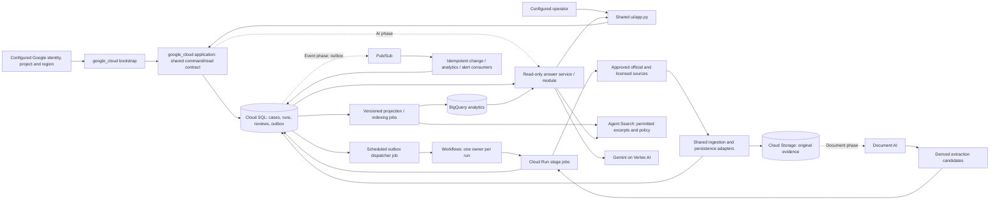
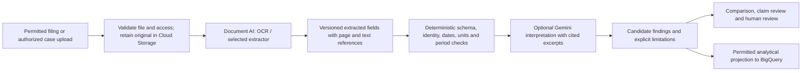
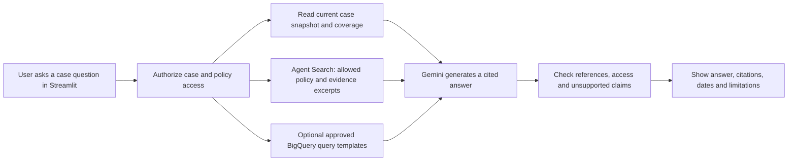

# Google Cloud profile

Proposed service/flow design from the 2026-10-14 provider discussion.
No Google runtime, adapter, installation or cloud access is implemented/verified.
Google is the requested next provider; configuration still rejects it.

[Scope](../product/scope.md) owns the direct configured identity/project/location
delivery and deferred product signup. [Component layout](../architecture/components.md)
owns root provider placement and current dependency gaps. [TS-039](../backlog/TS-039.md)
owns implementation and acceptance work. This profile owns only Google-specific
service, evidence and extension flows.

## Google Cloud architecture choices

Preserve Python/Pydantic domain contracts and the Streamlit experience. Translate
the execution graph into **Google Cloud Workflows**, which invokes **Cloud Run
Jobs** for research and processing. Workflows is the single native execution owner
for a run; stage jobs call reusable components rather than starting a second full
LangGraph orchestration. Local LangGraph remains useful for the current local flow.

Use **Cloud SQL for PostgreSQL** as the initial application database, **Cloud
Storage** for original evidence, and **BigQuery** for analytical projections.
Add the suggested AI and event services in separate, bounded delivery phases.
This is a proposed service selection; sizing, geography, licensing, source access
and operational acceptance still need installation-specific decisions.

### Technology and responsibility map

| Technology | Role in the Google profile | Delivery position |
| --- | --- | --- |
| Streamlit on Cloud Run | Intake, identity confirmation, case progress, comparison, evidence and human review | Initial application profile; Streamlit remains the sole user-facing surface |
| Cloud Run Jobs | Execute reusable source, specialist, aggregation, validation and reconciliation components | Initial research profile; one parameterized stage image can serve multiple stages |
| Workflows | Identity gate, bounded specialist fan-out/join, retries and finalization | Initial research profile |
| Cloud SQL for PostgreSQL | Cases, requests, runs/attempts, source-run metadata, finding references, snapshots, reviews and transactional outbox | Initial operational system of record |
| Cloud Storage | Exact source responses, original uploaded documents and versioned processing artifacts | Initial evidence profile |
| BigQuery | Portfolio, coverage, freshness, research/review metrics and later financial/transaction analytics | Analytics phase; derived data does not own case/review writes |
| Gemini on Vertex AI | Structured extraction assistance, summaries and conversational answers with permitted evidence | Governed AI phase; model output remains a candidate |
| Vertex AI predictive/classification models | Evaluated document/event classification and, if separately scoped, transaction prioritization | Later; requires labeled data and an approved use case |
| Document AI | OCR and schema-based extraction for supported financial and other document types | Document phase; validate processor/language/layout suitability |
| Vertex AI Search / Agent Search | Retrieve approved policy, knowledge and evidence excerpts for grounded answers | Search phase; validate access controls before private content is indexed |
| Pub/Sub | Decouple source-change, analytical and notification events; later transaction ingestion | Event/monitoring phase; consumers must tolerate duplicates |
| Cloud Scheduler | Trigger bounded source refresh and outbox/reconciliation jobs | Installation support; schedules activate only at the relevant readiness gate |
| IAM, service accounts and Secret Manager | Workload authorization and source credential references | Initial profile |
| IAP or the chosen OIDC identity provider | Future product user authentication and membership | Deferred from first direct configured-account delivery; cloud IAM/credentials still apply |
| Artifact Registry and build/deployment tooling | Versioned container images and repeatable releases | Initial profile; proposed Terraform plus the repository's chosen CI |
| Cloud Logging, Monitoring and Audit Logs | Correlated operational records, alerts and access/change audit | Initial profile |

Google documentation currently uses **Agent Search** for the search offering
referenced as Vertex AI Search. Keep the retrieval adapter independent of display
names and verify API/resource availability for the selected location. See
[Agent Search APIs](https://docs.cloud.google.com/generative-ai-app-builder/docs/builder-apis).
The Vertex AI documentation links used here may redirect to Google’s newer platform
documentation; provider SDK/API selection must be checked during implementation.

### Choices that avoid unnecessary infrastructure

- Start with Cloud SQL PostgreSQL. Consider AlloyDB only after measured requirements
  justify it; it would replace the operational database choice rather than add a
  second competing case store. See [Cloud SQL overview](https://docs.cloud.google.com/sql/docs/postgres/introduction)
  and [AlloyDB overview](https://docs.cloud.google.com/alloydb/docs/overview).
- Keep provider command/read implementations under root google_cloud/application/;
  the shared Streamlit process may call them as Python services initially.
  A consolidated authenticated Cloud Run control/event service can be introduced
  when external integrations require it. A dedicated service per specialist and
  an always-running worker are not requirements.
- Use Workflows and jobs for the case DAG. Composer is an option only if an
  installation requires Airflow; Dataproc is optional large-scale batch compute.
  Neither is needed to run every connector. Agent Engine is not the case execution
  owner in this profile.
- Start with existing deterministic specialists. AI services enhance evidence
  processing after the durable research and review path is verified.

## Google Cloud topology

The evidence path is mandatory; AI, document, analytics and event extensions are
phased. The diagram shows logical components, not one deployed microservice per
box. Build one shared Python package and a small set of images/entry points.

## Primary flow: case intake to research and human review

| Step | Application action | Google implementation and durable output |
| --- | --- | --- |
| 1. Load configured installation | Use configured Google identity/project/location; no product login/signup | Google bootstrap verifies credentials/capabilities and binds the trusted single-operator installation context |
| 2. Submit | Collect party name, jurisdiction and authoritative identifiers | Streamlit command layer validates input and atomically stores request plus dispatch outbox record in Cloud SQL |
| 3. Dispatch | Return queued case ID; work continues after the browser closes | Dispatcher reconciles the outbox and starts a Workflows execution correlated with the logical run ID |
| 4. Resolve identity | Run registry discovery/exact lookup and show match reasons | Identity job uses current registry/resolution components and persists verified observations and identity research |
| 5. Clarify if needed | Return candidates, missing fields or identity conflicts | Persist a clarification state and end this execution; confirmed input creates a new input version/run linked to earlier evidence |
| 6. Research | After confirmed identity, run sanctions, ownership/leadership, legal and news branches | Workflows launches stage jobs in bounded parallel branches; each records attempts, source-run coverage and output references |
| 7. Preserve evidence | Keep what each source actually returned before releasing records | Cloud Storage exact payload plus verified Cloud SQL observation manifest and source-run metadata |
| 8. Compare | Show agreement, duplicates, potential conflicts, chronology and gaps | Existing aggregation service; versioned output persisted in Cloud SQL or referenced artifacts |
| 9. Validate | Check structure/lineage; perform separate claim-support review when implemented | Existing EvidenceValidator plus future independently verifiable claim controls; no automatic promotion from structural pass to truth |
| 10. Assess and route | Present an explainable route and any approved policy output | Start with current `not_scored` behavior and analyst review; add eligible-evidence scoring only through the scoring backlog |
| 11. Review | Record rationale, references and request-details/reject/review actions | PostgreSQL ReviewStore uses snapshot hash, expected version and idempotent command ID; configured trusted actor context stays server-side, with user signup/membership deferred |
| 12. Read and retain | Display the board, timeline, coverage and review history | Streamlit reads the authoritative case version; BigQuery receives a separate analytical projection later |

Workflows supports parallel calls and joins, and can invoke Cloud Run jobs through
its connector. The job must finish and its durable output must be reconciled before
dependent stages proceed. See [parallel steps](https://docs.cloud.google.com/workflows/docs/execute-parallel-steps)
and [jobs from Workflows](https://docs.cloud.google.com/run/docs/triggering/invoke-jobs-with-workflows).

### Example user experience

An analyst enters a supplier’s legal name and registry identifier. If two parties
share that name, the application asks the analyst to confirm the exact party.
After confirmation, the case shows independent research progress. The final board
can show a supported registry record, parent-accounting relationships, a sanctions
name candidate needing attribution, a dated legal event, and an unavailable news
source. The reviewer sees each limitation and records a reasoned action.

The Google implementation must preserve these distinctions. A finished workflow,
complete source coverage, verified claims and an approved counterparty are separate
states. None follows automatically from the others.

## State, evidence and analytics contracts

### Operational state: Cloud SQL

Proposed logical tables cover requests/cases and input versions; workflow runs,
stage attempts and execution mappings; source runs and observation manifests;
identity research; findings/aggregation/validation snapshots; review actions;
source configuration; outbox/inbox records; and, later, monitoring subscriptions.
Use relational constraints and parameterized queries, not Snowflake SQL copied into
PostgreSQL.

Every case operation is tenant-bound. Unique request/command keys prevent duplicate
intake and review actions. Transactional claims and attempt fencing prevent two
workers from publishing competing stage results. Reviews compare the submitted
snapshot and expected version with the stored case. Append-only application history
does not imply immunity from database-administrator changes; separate audit controls
and restore verification remain necessary.

### Original evidence: Cloud Storage plus verified manifests

1. Keep original permitted response bytes/text and their original content hash.
   Do not hash a reserialized JSON representation as a substitute for retained bytes.
2. Write an object using create-only/generation preconditions and record its object
   generation, format, size, source ID/record ID, connector version and retrieval time.
3. Read back the retained content and verify the existing SHA-256 contract. Store
   a committed metadata manifest only after verification; keep publication time
   separately when the source provides it.
4. Return the existing ObservationReceipt only when both object and metadata are
   verified. Keep the current pipeline rule: failed or unknown storage outcomes do
   not release records as successful research.
5. Reconcile interrupted writes. Cloud Storage and PostgreSQL do not share one
   transaction: an uploaded orphan and a committed manifest with inaccessible bytes
   require explicit recovery states. Retrying must not overwrite evidence.

Preserve stable observation/case/finding IDs and lineage. Restricted customer
documents require tenant-isolated access; an object path prefix is not authorization.
Shared official-source snapshots may be reused only under their access/retention
rules, without exposing private case context.

### Analytical projections: BigQuery

Use BigQuery for historical trends and aggregate questions: source freshness,
coverage by jurisdiction, branch failure rates, review turnaround, portfolio changes
and later permitted financial/transaction features. It is designed for large-scale
analytics; see [BigQuery overview](https://docs.cloud.google.com/bigquery/docs/introduction).

Start with versioned batch projections from the operational outbox/artifacts. Keep
tenant, case/input version, event ID, observation IDs and projection timestamp in
the data. Deduplicate by stable event/version keys and display the projection’s
freshness. Do not use an eventually updated analytical row as authority to claim a
case, accept a review or decide whether a case has completed. Streaming/CDC can be
evaluated when volume and latency requirements justify it.

## Document flow: financial and non-traditional documents

This is a planned extension, particularly related to [TS-044](../backlog/TS-044.md).
The current SourceObservation format allowlist does not include PDF or general
images; add explicit document contracts rather than pretending existing source
connectors already accept arbitrary uploads.

Select a processor for the actual document family, language and layout. Document AI
offers OCR, parsing, classification and custom extraction; arbitrary documents need
evaluation rather than an assumed universal financial parser. See
[Document AI overview](https://docs.cloud.google.com/document-ai/docs/overview) and
[custom extractor](https://docs.cloud.google.com/document-ai/docs/custom-extractor-overview).

Retain processor/version, extracted span/page, confidence where available, original
hash and transformation history. Financial fields also need currency, units,
reporting period, accounting context and restatement/version relationships.
An uploaded bank statement or company report is a submitted disclosure, not an
officially verified registry fact. Missing data and extraction uncertainty remain
visible. Document processing does not establish solvency or fraud.

## AI flow: reasoning, classification and conversational answers

### Gemini on Vertex AI

Use Gemini for bounded extraction candidates, translation/summarization assistance
and explanations over permitted retained evidence. Responses must satisfy the
domain schema and carry evidence references; the application checks them before
display. Structured output controls response shape, not factual correctness. See
[structured output](https://docs.cloud.google.com/vertex-ai/generative-ai/docs/multimodal/control-generated-output).

Record the configured model/version, prompt/schema version, input evidence IDs,
output and validation result. Model failure leaves deterministic research available
with an explicit AI limitation. Models cannot select tenant credentials, change
identity, grant scoring eligibility, alter review decisions or run arbitrary SQL.

### Agent Search and policy retrieval

Maintain permitted, versioned policy/knowledge content separately from case
evidence excerpts. A retrieval request binds authenticated tenant/user, case/input
version, document access and policy effective date before content reaches a model.

Private data needs verified retrieval isolation, not only a prompt instruction or
caller-supplied filter. Prefer a physically isolated private data store per tenant
for the first profile if suitable for cost and scale; require authorized selection
of that store and recheck document/case access. Shared policy content is allowed
only where access rules permit it. Google documents data-source ACL support with
identity-provider prerequisites and a Preview designation; evaluate that feature’s
acceptance before depending on it. See
[Search access control](https://docs.cloud.google.com/generative-ai-app-builder/docs/data-source-access-control).

For example, “Why does this supplier require more information?” can cite unresolved
identity, a blocked source and the applicable policy. If the evidence cannot answer
a question, the interface says so. Search index delay, revoked access and deleted
evidence must be handled before retrieving or displaying excerpts.

Google Search grounding is an optional public discovery tool, distinct from the
private policy/evidence index. It produces leads requiring source-access, retention
and attribution checks; it does not bypass the official-source ingestion pipeline.
Evaluate its separate terms and data handling before use. See
[Google Search grounding](https://cloud.google.com/vertex-ai/generative-ai/docs/multimodal/ground-with-google-search).

### Predictive and classification models

Start with a clearly bounded task such as document type or event classification.
Any learned risk/transaction model needs a labeled dataset, time-separated evaluation,
false-positive/false-negative analysis, model versioning and drift monitoring.
Prediction is an input to governed assessment or triage, not a verified claim or
an automatic adverse decision. Training/deployment options are described in
[Vertex AI model training](https://docs.cloud.google.com/vertex-ai/docs/training-overview).
No predictive model or policy threshold is selected by this blueprint.

## Event flow: monitoring and optional transaction analytics

### Monitoring the existing legal-party use case

Cloud Scheduler triggers approved shared source-refresh jobs. Changed, verified
observations produce outbox events. A dispatcher publishes to Pub/Sub; an idempotent
consumer maps material changes to subscribed parties and queues a new case version.
The case runs through the same identity/evidence/review gates. Notification work
uses a separate outbox after the configured review/alert policy is satisfied.

Source refresh is distinct from per-case research. Reuse valid permitted snapshots,
respect per-source cadence/rate limits and show actual last-successful retrieval.
An event bus does not make a delayed source real-time. Monitoring and notifications
remain related to [TS-009](../backlog/TS-009.md), [TS-028](../backlog/TS-028.md) and
[TS-049](../backlog/TS-049.md).

### Optional transaction processing

Transaction monitoring expands the current product. The repository has no completed
transaction ingestion, customer financial-data contract or transaction model. Define
a separate bounded child scope under the provider/integration work before coding;
the suggestion of Pub/Sub and BigQuery alone does not establish AML/payment-product
requirements or authorize financial-data access.

```mermaid
flowchart LR
    T[Authorized transaction producer] --> P[Pub/Sub: versioned event]
    P --> I[Authenticated Cloud Run event consumer]
    I --> D[Validate, deduplicate and resolve counterparty IDs]
    D --> B[BigQuery transaction facts and analytical features]
    B --> M[Optional evaluated Vertex AI prediction]
    M --> R[Governed triage rules]
    D --> R
    R --> C[Persist alert / enqueue legal-party research case]
    C --> H[Existing evidence and human review flow]
```

A proposed event contract needs tenant/event ID, schema version, producer, occurrence
and ingestion times, stable transaction/counterparty identifiers, amount/currency,
permitted purpose and correction references. Unresolved party mappings go to review.
Batch BigQuery analytics is suitable for an initial analytical use case; strict
per-transaction latency/windowing needs separate design and may justify Dataflow
or another bounded streaming processor. It is not promised by this flow.

### Duplicate delivery and reliable handoff

Design Pub/Sub consumers for at-least-once processing. Push subscriptions do not
support Pub/Sub exactly-once delivery; even delivery guarantees do not make database,
analytics and business side effects one transaction. See
[exactly-once delivery](https://docs.cloud.google.com/pubsub/docs/exactly-once-delivery)
and [push delivery](https://docs.cloud.google.com/pubsub/docs/push).

Persist accepted events in a deduplicated inbox and enqueue durable downstream work
before acknowledging. Retry known transient failures within budgets and route
poison events to controlled dead-letter handling. Outbox records prevent loss between
case/review commits and event publication. Track publish and execution-start outcomes:
an unknown response needs reconciliation, not blind redispatch. Bind one active native
execution to each logical run with an atomic ownership claim; duplicate executions
must exit without starting stages. Use attempt fencing for expired-owner recovery.

## Mapping the Snowflake foundation to Google Cloud

| Existing Snowflake capability or target | Google counterpart | Porting boundary |
| --- | --- | --- |
| Streamlit app/local UI | Streamlit container on Cloud Run | Connected authorization/progress/review is still work for both profiles |
| Tasks and Python procedures | Workflows and Cloud Run stage jobs | Translate DAG ownership, retries, inputs and output/status reconciliation |
| RAW observations and response chunks | Original Cloud Storage objects plus PostgreSQL manifests | Preserve exact bytes, stable hashes, verification receipts and replay semantics |
| OPS source runs and case/stage attempts | PostgreSQL source/run/attempt tables | Reimplement SQL, transactions, constraints and concurrency guarantees |
| CORE/serving case data | PostgreSQL read models; separate BigQuery projections | Complete normalized cache and serving are shared backlog work |
| Planned Cortex extraction | Gemini on Vertex AI and Document AI | Typed candidate output plus deterministic evidence checks |
| Planned Cortex Search | Agent Search | Permitted indexing, isolation, citation mapping and freshness |
| Planned Cortex Agent/analytical answers | Gemini with bounded retrieval/read tools and BigQuery templates | Read-only case QA; no arbitrary model-generated privileged SQL |
| Snowflake Secrets / runtime grants | Secret Manager, workload service identities, IAM and database roles | New customer-owned identities and secrets; no copied Snowflake credentials |
| Planned refresh/notification tasks | Scheduler, jobs, Pub/Sub and outbox consumers | Source cadence and delivery guarantees must be measured |

This is a complete Google-only target profile. Snowflake storage or Cortex is not
silently retained in the Google execution path. A hybrid installation would need
its own explicit data-boundary and operational design.

## Migration from Snowflake

A fresh Google installation does not require migrating Snowflake customer data.
If migration is requested, define an explicit cutover/version boundary and export
only permitted evidence, case versions, run lineage and reviewer history. Preserve
stable IDs, exact retained bytes/hashes, source rights, original times and audit
references; verify object and record counts plus hashes after import. Differences in
SQL types, timestamp handling and review concurrency need conformance checks.
Use new Google workload identities and customer-owned secret references rather
than copying Snowflake keys. Reconcile active runs, retained snapshots and access
rules before cutover, with a rollback path that preserves subsequent history.
## Delivery ownership

[TS-037](../backlog/TS-037.md) owns contract cleanup/conformance,
[TS-038](../backlog/TS-038.md) owns capability checks and installation, and
[TS-039](../backlog/TS-039.md) owns concrete Google stores and native execution.
Use the [backlog](../backlog/README.md) rather than a parallel GCP task register.
Create bounded linked child issues there for actual implementation.

First delivery is the existing research/review flow: PostgreSQL operational state,
verified Cloud Storage evidence, Workflows/stage jobs and the same configured-operator
Streamlit UI, with explicit unscored output. Shared TS-002/003/008/021/022/027 work
still governs runtime, cache, recovery, review and UI integration. BigQuery, documents,
AI/search, Pub/Sub monitoring and transactions are later capability gates, each under
its existing product owner or an approved bounded extension. A cloud port does not
complete claim verification, scoring or production tenancy.

## Installation and acceptance

### Installation lifecycle

Follow the existing doctor → plan → approved apply → smoke → deploy UI lifecycle
in TS-038. Preflight must check project and billing, permitted geography, enabled
APIs, quotas, runtime packages, database/storage connectivity, workload identities,
source egress and optional AI/processor/search capability. Proposed configuration
contains project/location/resource and secret references, never customer secrets.

Provision versioned infrastructure and PostgreSQL migrations; deploy immutable
images; verify evidence/run/readback and failures; then connect the common Streamlit
UI through the configured provider application interface. Enable schedules after their
specific gates pass. Restore tests, rollback/upgrade handling and data-preserving
uninstall remain part of the profile, not implied by a successful first install.

### Configured cloud identity and Streamlit lifecycle

The first implementation reads configured Google credentials and project/location
directly through root google_cloud/bootstrap/. Cloud API authorization is separate
from product login/signup, which is deferred. Validate the application credential
path; an active CLI account or Google email does not itself prove Python clients
have application credentials. See [ADC](https://docs.cloud.google.com/docs/authentication/application-default-credentials)
and [gcloud authentication](https://docs.cloud.google.com/docs/authentication/gcloud).

Future signup-based tenancy may introduce IAP/OIDC and a membership store; that is
not a prerequisite for directly configured single-operator mode. See
[IAP for Cloud Run](https://docs.cloud.google.com/run/docs/securing/identity-aware-proxy-cloud-run).

Streamlit uses persistent browser connections. Cloud Run supports WebSockets, but
connections are subject to request timeout and affinity is best effort. Reconnect
must reload case state from the database rather than depend on the original instance.
Test uploads, configured installation-context binding and review resubmission across reconnects. See
[Cloud Run WebSockets](https://docs.cloud.google.com/run/docs/triggering/websockets).

### Cost and operations

Estimate costs from actual workload before installation: cases/day, sources/case,
payload volume/retention, document pages, model input/output, search index/query volume,
BigQuery bytes scanned, transaction event rate and refresh cadence. Cloud SQL has
provisioned-instance cost even when research jobs are idle; AI endpoints/search
capacity and HA choices can add standing cost. No amount or free-tier sufficiency
is assumed here.

Bound job instances/concurrency, source fetch/pagination/time budgets, retries,
model tokens, document pages and analytics query scope. Use partitioned analytical
tables and controlled query templates; set billing alerts plus application/service
limits, because a billing alert is not a hard spending cap. Keep separate source,
workflow, review, indexing and AI metrics with correlation IDs and redacted logs.

### Evidence required before saying Google Cloud is supported

Capture the reviewed commit/image digests, infrastructure/migration versions,
project/location capability report and each verification mode separately:

1. **Offline:** contract and failure tests; unsupported profiles fail without a
   connection; existing Snowflake behavior still passes.
2. **Approved live slice:** actual source → original object/hash readback → identity
   → specialist output → comparison/validation → unscored case → configured-actor review.
3. **Recovery/replay:** process/browser interruption, duplicate dispatch, expired
   ownership, unknown writes and concurrent reviews preserve the same durable history.
4. **Installation/operations:** clean installation, migration/upgrade, backup/restore,
   installation/actor binding and service failures on the chosen profile. Future
   multi-user signup/membership carries additional separate acceptance gates.
5. **Optional capability acceptance:** documents, AI/search, monitoring and transactions
   carry their own evaluation and source/access evidence before being enabled.

This document establishes the separate Google approach and its work breakdown.
It does not change application behavior, issue completion, cloud resources or
the current unsupported-provider guard.

Platform references are design research, not a fresh availability/entitlement check.
Recheck API names, feature maturity, geography and quotas when implementing the profile.
