# GLEIF, Streamlit and Google Cloud implementation plan

This is the execution plan for connecting the verified GLEIF component to the
selected `ui/app.py` and then running the same application contract on Google
Cloud. The [Google Cloud profile](../docs/deployment/google-cloud.md) owns service
architecture, [component layout](../docs/architecture/components.md) owns dependency
boundaries, and [TS-003](../docs/backlog/TS-003.md),
[TS-027](../docs/backlog/TS-027.md), [TS-037](../docs/backlog/TS-037.md),
[TS-038](../docs/backlog/TS-038.md) and [TS-039](../docs/backlog/TS-039.md) own
acceptance work. This file adds no parallel backlog.

## Verified starting point

| Component | Current evidence | Integration consequence |
| --- | --- | --- |
| `GleifAdapter.search_by_name` | Fresh public API and local contract tests pass | Use for discovery only; return all candidates and require explicit confirmation |
| `GleifAdapter.fetch_by_lei` | Fresh public API and local contract tests pass | Exact retrieval still needs persisted evidence before a case can rely on it |
| `SourceRegistry` | GLEIF lookup/search/relationships dispatch exists | Reuse it; the UI and cloud provider do not call HTTP endpoints themselves |
| `IngestionPipeline` | Store/run protocols, persist-before-release behavior and failure tests exist | Inject provider stores; preserve the release gate |
| `gleif_registry_branch` | Supports name and LEI flows | Its fallback discovers `.env` and Snowflake stores, so reusable execution is not yet provider-independent |
| `ui/app.py` | Demo and GLEIF modes submit directly to synchronous `run_case` | It needs an injected application service and a visible two-step candidate flow |
| Google provider | Documents only; shared config rejects `google` | Implement composition and persistence before adding Google to runtime selection |

The 2026-10-15 live check used `Microsoft Corporation` and
`INR2EJN1ERAN0W5ZP974`. It proved connector HTTP and normalization, not persistence,
UI behavior or Google Cloud.

## Target user flow

The two GLEIF operations remain separate:

1. **By name:** submit a legal name, persist the source response and run record,
   show every candidate with legal name, LEI and jurisdiction, then wait for the
   user to select one. Do not start specialists or scoring.
2. **By LEI:** submit or confirm a legal name and LEI, retrieve that exact record,
   persist and read back its evidence, compare it with the submitted party, then
   create or continue the durable case only when the identity gate resolves.

```mermaid
flowchart LR
    UI[Shared Streamlit UI] --> APP[Provider-neutral application contract]
    APP --> PIPE[Shared IngestionPipeline]
    PIPE --> GLEIF[Shared GLEIF connector]
    GLEIF --> OBJ[Original response store]
    OBJ --> META[Observation and source-run store]
    META --> VERIFY[Hash and metadata readback]
    VERIFY --> CAND[Candidates or exact identity]
    CAND --> UI
    CAND -->|confirmed exact identity| CMD[Durable case command]
    CMD --> DAG[Provider workflow owner]
```



The UI never imports a Google or Snowflake SDK. It receives one configured
application implementation from the installation's composition root.

## Application contract

Add a small shared contract under `src/trust_signal/application/`:

```python
class TrustSignalApplication(Protocol):
    def search_identity(self, command: IdentitySearchCommand) -> IdentitySearchResult: ...
    def submit_case(self, command: SubmitCaseCommand) -> CaseReceipt: ...
    def get_case(self, case_id: str) -> CaseView: ...
```

`IdentitySearchResult` carries candidates, coverage, limitations, source-run ID
and persisted observation references. `CaseReceipt` returns a stable case/request
ID immediately. `CaseView` carries durable status and final projections. Reviewer
commands can extend this same contract later with snapshot/version checks.

Keep provider credentials, database sessions and trusted actor context behind the
implementation. Do not place raw source bodies, access tokens or cloud clients in
Streamlit session state.

## Delivery sequence

### 0. Correct the current UI boundary

- Move `run_case` construction out of `ui/app.py`; make the rendering layer accept
  a `TrustSignalApplication` instance.
- Label or remove hard-coded source health, Snowflake/Cortex, latency, score and
  default-dossier claims that are not derived from the current result.
- Keep demo fixtures clearly marked and structurally separate from live evidence.
- Preserve the current launcher while adding a test application implementation.

Completion check: Streamlit component tests supply a fake application, render no
unverified operational claim, and never open a cloud connection during import or
rerender.

### 1. Make identity execution injectable

- Require `gleif_registry_branch` to receive an `IngestionPipeline`; retain any
  Snowflake convenience construction only in a Snowflake composition wrapper.
- Keep `GleifAdapter`, `SourceRequest`, identity resolution and domain results in
  the shared package.
- Add application-level mapping from `IngestionResult` to candidate and exact-
  identity responses without exposing provider-specific receipts.
- Add contract tests for no match, several candidates, exact match, conflicting
  name, partial pagination, source error, store error and run-log error.

Completion check: the shared identity flow runs with in-memory test stores and
with an injected Snowflake implementation; importing it does not load Snowflake.

### 2. Implement the two-step Streamlit flow

- In **Search by name**, call `search_identity`, render candidate rows, and require
  an explicit selected LEI. Preserve coverage and limitations beside the results.
- In **Search by LEI**, require both the LEI and expected legal name, then call
  `submit_case` through the exact-identity path.
- Confirmation resubmits the selected legal name and LEI; it never trusts a hidden
  row index or automatically chooses the first search result.
- Save stable search/case IDs in session state. Reload status with `get_case` so a
  rerender or browser reconnect does not rerun source retrieval.
- Render `queued`, `running`, `needs_more_information`, `completed_with_gaps`,
  `completed` and failure states from actual backend values.

Completion check: an AppTest covers name search → four candidates → select the
Microsoft LEI → exact confirmation, plus no-match, conflict and backend-failure paths.

### 3. Implement Google persistence and composition

Create a distinct provider package under `google_cloud/`:

- `bootstrap/`: validated project/location/resource settings, ADC diagnosis and
  runtime construction; no provisioning on import.
- `adapters/`: Cloud Storage original-response store plus Cloud SQL PostgreSQL
  observation manifests, source runs, identity/case projections and outbox.
- `application/`: `TrustSignalApplication` implementation binding configured
  installation and trusted actor context.
- `infrastructure/` and `deployment/`: reviewed resources, migrations, workload
  identities, image/version manifests, install and upgrade checks.

Cloud Storage retains exact decoded response bytes with create-only generation
preconditions. Cloud SQL records the object generation, SHA-256, source metadata,
run lifecycle and application projections. Because they do not share a transaction,
the adapter needs explicit prepared, verified, committed and reconciliation states.

Completion check: the Google implementation passes the same application/store
contract suite as the test and Snowflake implementations, including interruption
after every object/database write boundary and concurrent duplicate commands.

### 4. Verify the first Google live slice

Run the shared GLEIF connector through the Google-composed application using an
approved project and workload identity:

1. Search `Microsoft Corporation` and persist all returned candidate evidence.
2. Select `INR2EJN1ERAN0W5ZP974` and execute exact lookup.
3. Read original bytes back from Cloud Storage and verify their SHA-256.
4. Read the observation and terminal source run from Cloud SQL.
5. Confirm the identity result references the verified observation.
6. Replay saved evidence without a new HTTP call and verify idempotent history.

Completion check: record project/location, revision/image, run/observation IDs,
object generation, hashes, migrations and exact test results. This establishes a
bounded Google identity slice, not the complete provider.

### 5. Add durable case execution

- `submit_case` writes the case command and transactional outbox in Cloud SQL and
  returns a receipt without waiting for research.
- A reconciliable dispatcher starts one Google Cloud Workflows execution per
  logical run. Workflows is the native owner; Cloud Run Jobs execute shared stages.
- Stage jobs receive stable IDs and input references, call shared components, and
  write versioned attempts/results. Duplicate delivery must be idempotent.
- The Streamlit app reads status/projections and can reconnect; browser closure
  does not cancel or lose the case.

Completion check: browser/process interruption, duplicate dispatch, source failure,
job retry and workflow timeout preserve one logical history and explicit gaps.

### 6. Complete operational acceptance

Verify clean installation and upgrade, IAM separation, tenant/installation binding,
quotas, telemetry, redaction, backup/restore, cancellation, cost limits and rollback.
Measure name-search and exact-lookup latency instead of displaying placeholders.
Optional Gemini, retrieval, documents and analytics remain disabled until their
own evidence, rights and evaluation gates pass.

## Test gates

| Gate | Required proof |
| --- | --- |
| Connector | Mocked protocol/error tests plus separately recorded fresh HTTP |
| Shared application | Same contract suite against in-memory and provider implementations |
| Evidence | Exact byte/hash and metadata readback before normalized records are released |
| UI | AppTest for candidate selection, exact confirmation, reconnect and all failure states |
| Google integration | Approved live source → Storage/Cloud SQL readback → identity result |
| Workflow | Restart, retry, duplicate dispatch, partial branch and cancellation tests |
| Operations | Install/upgrade/restore, IAM denial, quota/cost and telemetry evidence |

Each report must state fixture, replay, fresh HTTP, persisted readback, managed
execution and production-readiness boundaries separately.
